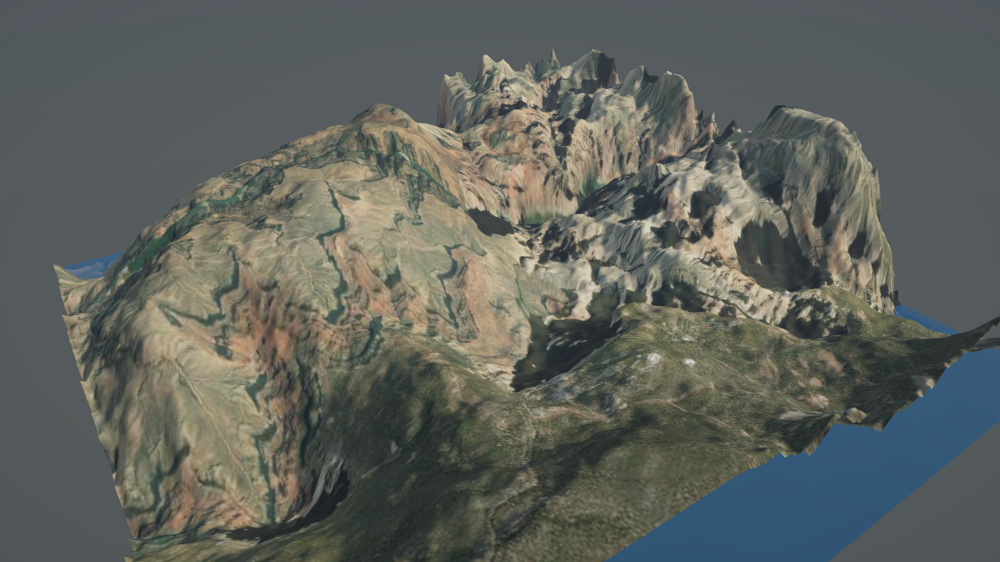
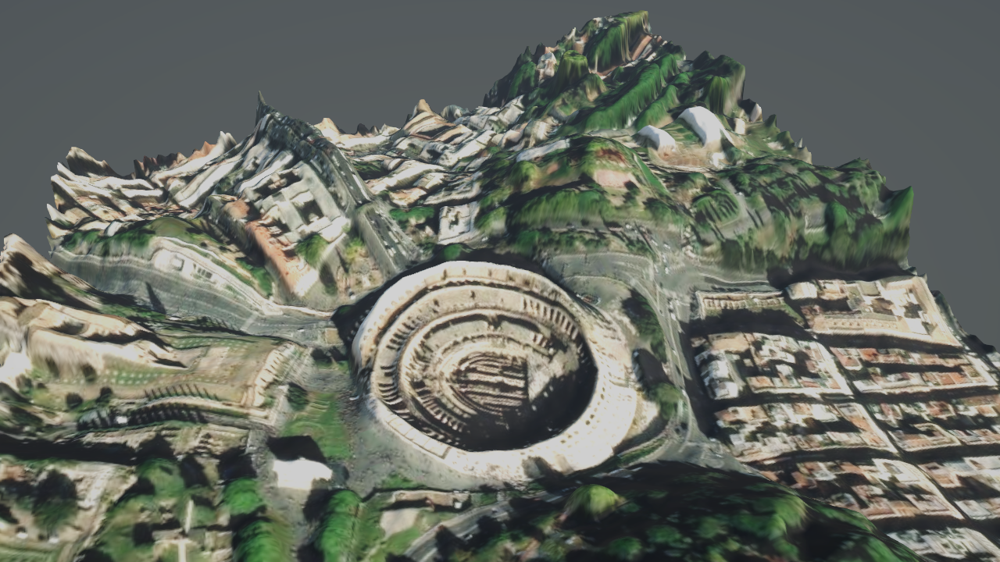
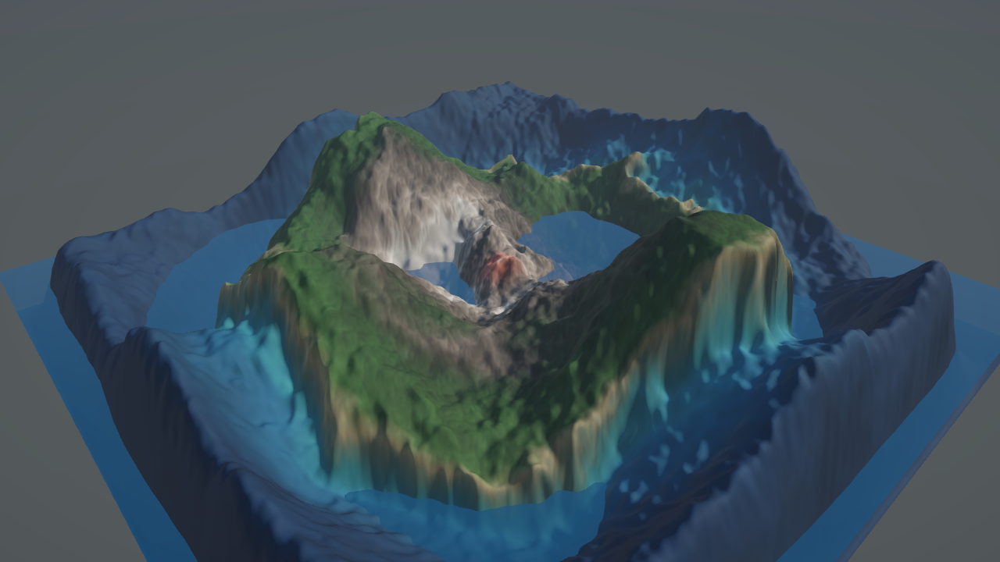
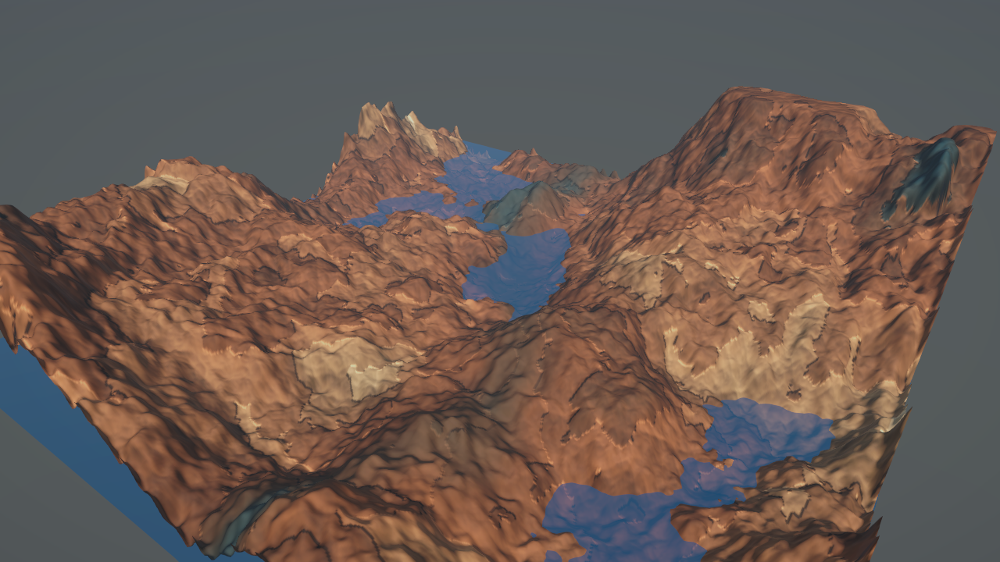

# Depth Terrain — Apple Depth Pro 2 → Unity 6 Terrain Pipeline

End-to-end **Apple Depth Pro 2** (`apple-aiml-research/ml-depth-pro-2`) monocular depth estimation pipeline and modular **Unity 6 (URP)** toolkit that reconstructs playable, lit **3D Unity Terrains** from:

- **Real-world satellite & map tiles** (Esri World Imagery, Esri Shaded Relief, OpenStreetMap, OpenTopoMap, CartoDB Voyager, or any custom `{z}/{x}/{y}` XYZ tile server + OpenStreetMap Nominatim place-name geocoding)
- **Local top-down images** (drone photos, orthoimagery, or hand-drawn/AI-generated fictional top-down maps)
- **Procedural fictional top-down worlds** (4 sunlit Perlin-noise aerial biomes fed directly into Apple Depth Pro 2)
- **Aerial / drone videos** (temporally consistent `infer_video` multi-frame depth sequences with Unity frame scrubbing)

> Full model research report: [docs/DEPTH_PRO_2_RESEARCH.md](docs/DEPTH_PRO_2_RESEARCH.md)

---

## Unity 6 URP Showcase Renders (Generated Live with Apple Depth Pro 2)

All terrains below were reconstructed from 2D top-down RGB imagery through **Apple Depth Pro 2 (`depthpro2-b`, `multiscale_tta`, Apple Silicon MPS `bfloat16`)** into 513×513 16-bit Unity `TerrainData` heightmaps with 1:1 UV-aligned URP `TerrainLayer` textures and DXT5nm normal maps:

| Real Satellite: Grand Canyon, USA | Real Satellite: Colosseum, Rome |
| :---: | :---: |
|  |  |

| Fictional Top-Down: Volcanic Island | Fictional Top-Down: Canyon Mesa |
| :---: | :---: |
|  |  |

---

## Why Apple Depth Pro 2?

**Apple Depth Pro 2** ([arXiv:2611.26603](https://arxiv.org/abs/2611.26603)) is Apple Machine Learning Research's latest foundation model for **fast, sharp, and temporally consistent metric monocular depth estimation** across **single photos, full videos, and live camera streams**.

- **Unified Image & Video Backbone**: DINOv3 Vision Transformer + cross-frame MultiViewEncoder + DPTDecoder + shared auxiliary FOV/focal-length estimator (94 MB).
- **4 Model Sizes**:
  - `depthpro2-s` — 24M params (97 MB): up to **102 fps** single-frame / **76 fps** streaming on Apple Silicon Core ML.
  - `depthpro2-b` — 97M params (386 MB): ~**445 ms** single-pass at 768×768 on Apple M3 (`mps`, `bfloat16`).
  - `depthpro2-l` — 334M params (1.3 GB)
  - `depthpro2-h` — 872M params (3.5 GB)
- **Top-Down Nadir Adaptation (`multiscale_tta`)**: General monocular depth models exhibit perspective camera-tilt and corner-tunnel priors on 90° nadir satellite imagery. Our pipeline eliminates those artifacts using **4-way rotational TTA (0°/90°/180°/270°)**, **least-squares linear plane detrending**, **positive-only radial debiasing**, and **3×3 half-overlapping local Depth Pro 2 patch fusion** with smooth Hann blending.

---

## Architecture

```
┌────────────────────────────────────────────────────────────────────────────┐
│  Top-Down Input Sources                                                    │
│  • Real Maps (OSM Nominatim + Esri Satellite / OSM / OpenTopoMap / Custom) │
│  • Local Aerial Image (.png / .jpg / .webp / .heic)                        │
│  • Fictional Top-Down Generator (Volcanic / Alpine / Canyon / Archipelago) │
│  • Aerial Drone Video (.mp4 / .mov — temporally consistent infer_video)    │
└───────────────────────────────┬────────────────────────────────────────────┘
                                │
                                ▼
┌────────────────────────────────────────────────────────────────────────────┐
│  pipeline/ — Python (uv) + Apple Depth Pro 2 (MPS / CUDA / CPU)            │
│  • depth_runner.py      : Model loader, multiscale_tta / tta4 / raw, video │
│  • map_fetcher.py       : Nominatim geocoder + Slippy XYZ tile stitcher    │
│  • fictional_generator.py: 2D gradient Perlin sunlit aerial RGB synthesis  │
│  • heightmap_export.py  : 16-bit LE RAW (2^n+1) + PNG16 + Turbo + metadata │
└───────────────────────────────┬────────────────────────────────────────────┘
                                │  albedo.png · heightmap.raw · depth_preview.png · metadata.json
                                ▼
┌────────────────────────────────────────────────────────────────────────────┐
│  DepthTerrainUnity/ — Unity 6 (6000.6.0f1) URP 3D Module                   │
│  • HeightmapProcessor     : 16-bit RAW decode, smooth, gamma, DXT5nm norm  │
│  • DepthTerrainBuilder    : Terrain + TerrainData + Matte URP Layer + Water│
│  • DepthPipelineBridge    : Async `uv run depth-terrain` subprocess runner │
│  • DepthTerrainController : Presets, live inference, non-destructive tune  │
│  • DepthTerrainWindow     : Editor Studio (Tools > Depth Terrain > Studio) │
│  • RuntimeTerrainHUD      : Interactive Play Mode HUD + OrbitFlyCamera     │
│  • DepthTerrainCliCommands: Custom Unity Pipeline `[CliCommand]` suite     │
└────────────────────────────────────────────────────────────────────────────┘
```

---

## Quick Start

### 1. Set Up the Apple Depth Pro 2 Pipeline (`pipeline/`)

Requires macOS (Apple Silicon recommended), Linux, or Windows with [`uv`](https://docs.astral.sh/uv/) installed.

```bash
cd pipeline
uv sync --python 3.12 --extra dev

# Pre-download Apple Depth Pro 2 Small (97 MB) & Base (386 MB) + FOV estimator (94 MB)
uv run depth-terrain download --all-laptop
```

Generate Unity-ready terrain bundles from the CLI:

```bash
# Real-world satellite location by place name (geocoded via OpenStreetMap Nominatim)
uv run depth-terrain from-map \
  --place "Grand Canyon, Arizona, USA" \
  --provider esri_satellite --zoom 13 --grid 3 \
  -m depthpro2-b --topdown-mode multiscale_tta \
  -o out/grand_canyon

# Real-world location by coordinates + OpenTopoMap or custom XYZ tile template
uv run depth-terrain from-map \
  --lat 41.8902 --lon 12.4922 --zoom 17 --grid 3 \
  --provider esri_satellite -m depthpro2-b \
  -o out/colosseum

# Fictional top-down landscape -> Apple Depth Pro 2
uv run depth-terrain from-fictional \
  --biome volcanic_island --seed 42 --size 768 \
  -m depthpro2-b -o out/volcanic_island

# Any local top-down real photo or fictional map artwork
uv run depth-terrain from-image \
  -i /path/to/topdown_map.png -m depthpro2-b -o out/custom_map

# Aerial drone video (temporally consistent Depth Pro 2 video inference)
uv run depth-terrain from-video \
  -i /path/to/drone_clip.mp4 -m depthpro2-s --max-frames 16 -o out/drone_video
```

### 2. Open & Run in Unity 6 (`DepthTerrainUnity/`)

1. Open `DepthTerrainUnity/` in **Unity 6 (`6000.6.0f1`)** (or via `unity open ./DepthTerrainUnity`).
2. Open `Assets/Scenes/DepthTerrainShowcase.unity`.
3. **Play Mode**: Press **Play** to explore 5 bundled Apple Depth Pro 2 terrains immediately via the interactive **Runtime HUD** (`Drag` orbit, `Scroll` zoom, `WASD/QE` move, `R` reset), switch real/fictional presets, tweak elevation/water/smoothing/lighting live, or trigger live Depth Pro 2 generation for any place name or fictional biome!
4. **Editor Studio**: Open **`Tools → Depth Terrain → Depth Pro 2 Studio`** for the full tabbed authoring workflow (Real Map presets + custom XYZ URLs, Local Image picker, Fictional World generator, Aerial Video scrubber, S/B/L/H+ model selector, live RGB + Turbo Depth preview).

### 3. Unity Pipeline CLI Commands

With `com.unity.pipeline` active in the running Editor:

```bash
unity command depth_terrain_setup_scene --dataset grand_canyon_real_satellite
unity command depth_terrain_load --dataset colosseum_real_satellite --height 75 --water 0.0
unity command depth_terrain_frame_camera --yaw 22 --pitch 40 --distance 410
unity command depth_terrain_capture_game_png --output ./render.png --width 1280 --height 720
```

---

## Automated Verification

| Suite | Command | Result |
| :--- | :--- | :--- |
| Python Pipeline Tests | `cd pipeline && uv run pytest -v` | **8 passed** |
| Unity EditMode Tests | `unity command "test run" --mode editor --filter DepthTerrain` | **6 passed** |
| Unity Project Integrity | `unity projects verify ./DepthTerrainUnity` | **0 errors, 0 warnings** (183 files) |

---

## License

- Project source code: **MIT License** ([LICENSE](LICENSE)).
- **Apple Depth Pro 2** code and model weights are distributed separately by Apple Inc. under the **Apple Machine Learning Research Model License** (strictly for non-commercial scientific research and academic development). Model checkpoints are excluded from Git and downloaded locally from Apple's official CDN via `uv run depth-terrain download`.
